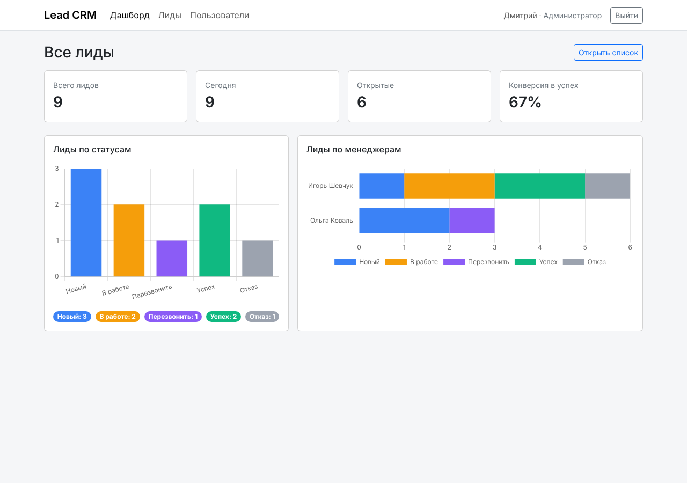
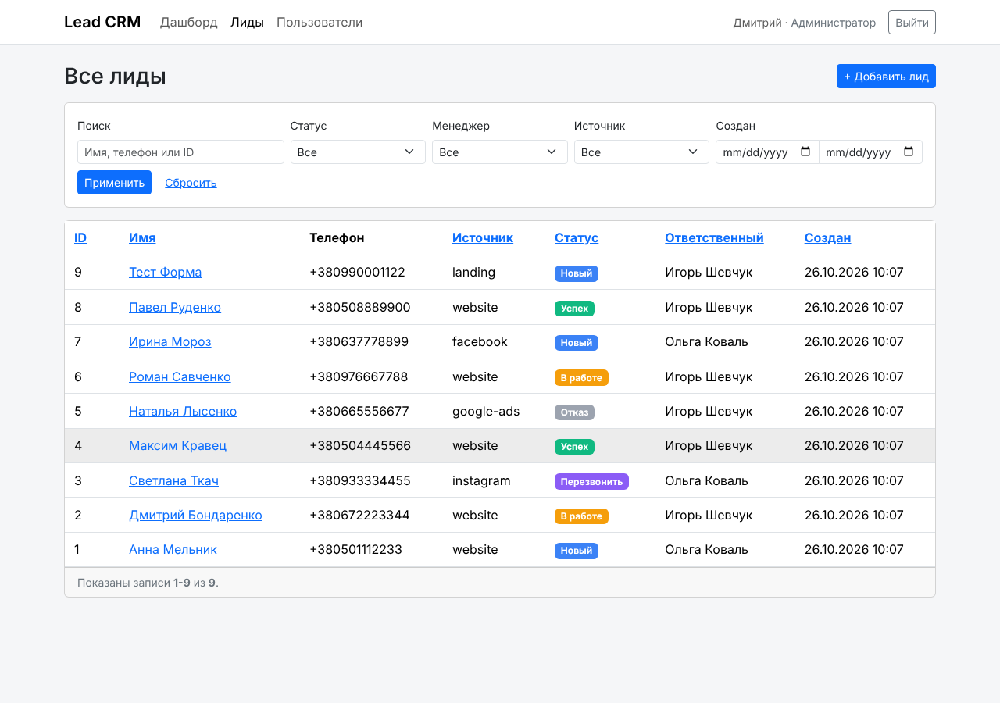
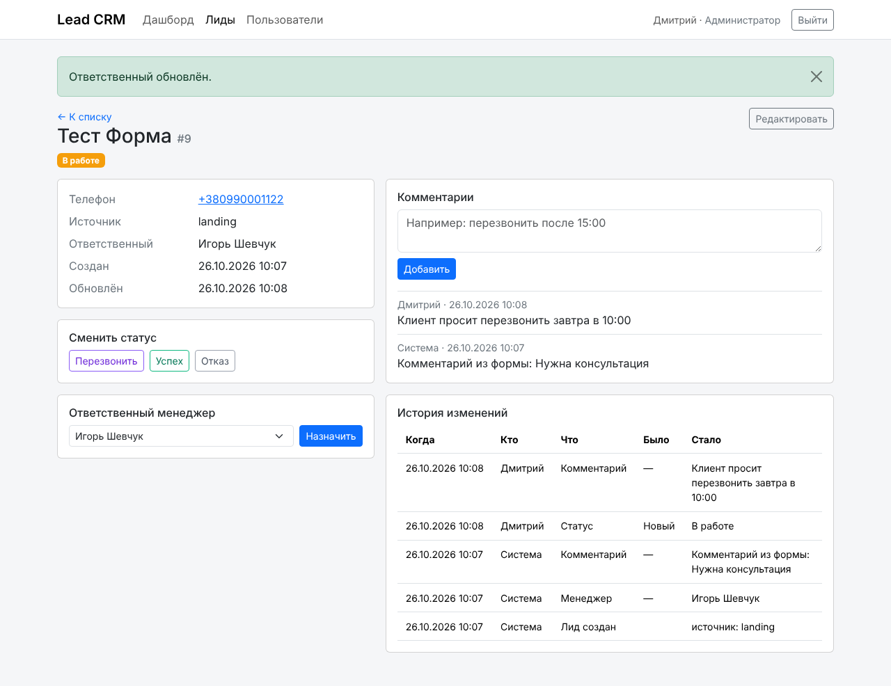
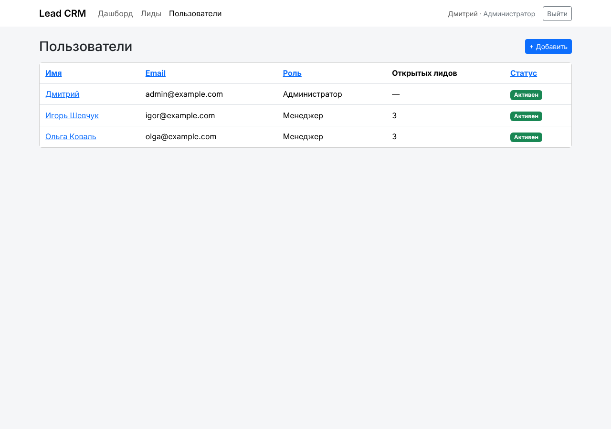
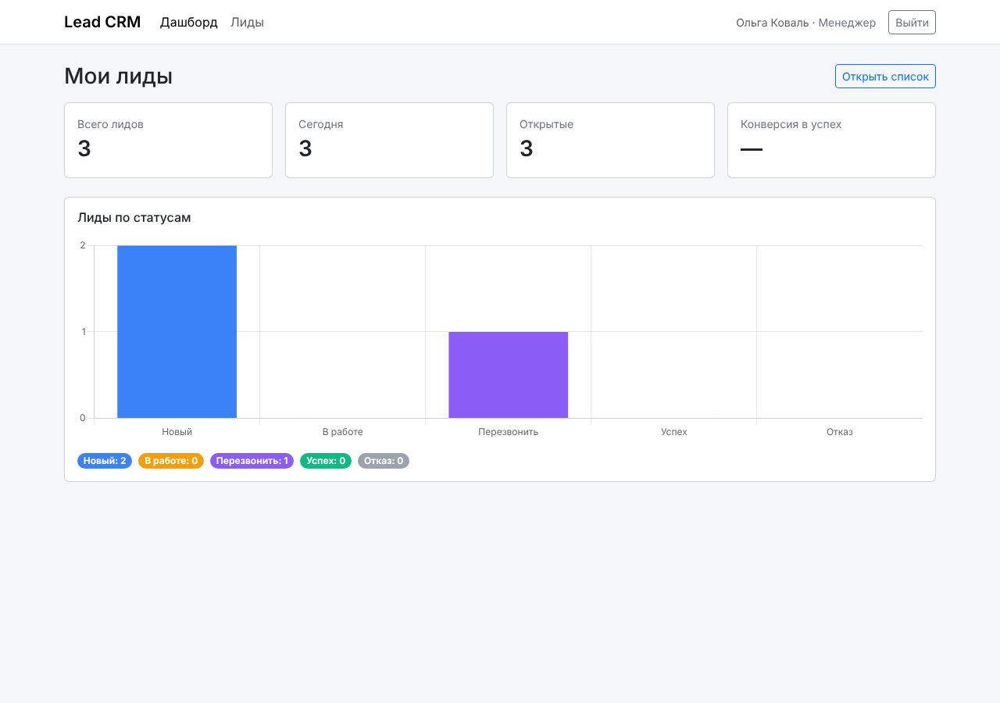
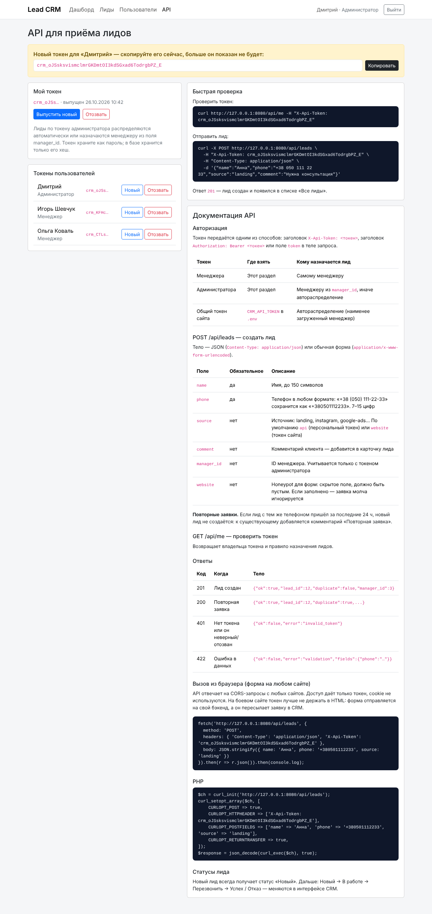
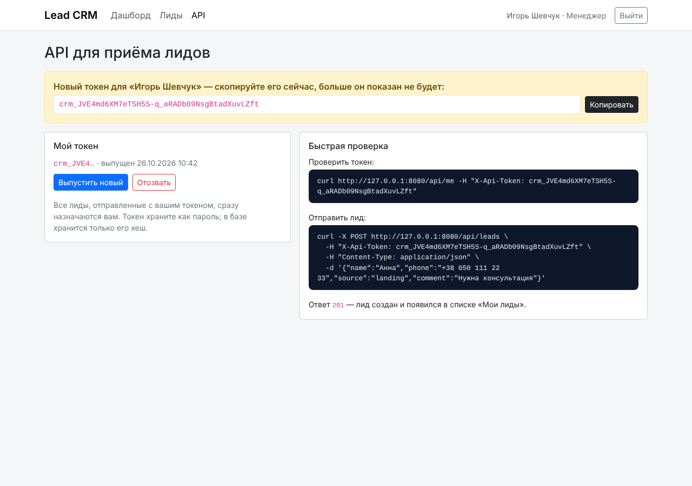

# Lead CRM

Базовая CRM для лидов на Yii2 (PHP 8.4, MySQL): заявки автоматически приходят с формы на сайте, менеджеры ведут их
по статусам, администратор распределяет лиды и управляет пользователями.

Проект сделан с помощью AI (Claude Code): архитектура, схема БД, матрица прав и статусная модель
спроектированы вручную и зафиксированы в [CLAUDE.md](CLAUDE.md), затем проект собирался небольшими
блоками с ревью и проверкой каждого.



## Демо

**https://devscripts.space** — рабочая версия с тестовыми данными.

| Роль | Email | Пароль |
|---|---|---|
| Менеджер | olga@example.com | demo12345 |
| Менеджер | igor@example.com | demo12345 |

Менеджер видит только своих лидов; в разделе **API** можно выпустить свой токен и отправить лид через curl —
он сразу появится в списке «Мои лиды».

## Возможности

| Функция | Как сделано |
|---|---|
| Приём лидов по API | `POST /api/leads` (JSON или форма). **Персональный токен у каждого пользователя**: лид по токену менеджера сразу назначается ему. Плюс общий токен для формы сайта. Вызов с любого сайта (CORS), honeypot от ботов. Повторная заявка с тем же номером за 24 ч не создаёт дубль, а добавляет комментарий |
| Раздел «API» | Выпуск и отзыв токенов (в БД — только хеш, токен показывается один раз), готовые curl-команды. Менеджер видит краткую инструкцию, админ — полную документацию и токены всех пользователей |
| Карточка лида | Имя, телефон (нормализуется), источник, статус, ответственный, комментарии |
| Статусы | Новый → В работе → Перезвонить → Успех / Отказ. Разрешённые переходы описаны в одном месте (`Lead::TRANSITIONS`). Закрытый лид может вернуть в работу только админ |
| Роли | **Администратор** видит всё, управляет пользователями, назначает ответственных. **Менеджер** видит только своих лидов: чужой лид отдаёт 404 (защита от IDOR) |
| Распределение | Ручное назначение админом + автоназначение нового лида наименее загруженному менеджеру (`CRM_AUTO_ASSIGN`) |
| История изменений | Кто, что и когда изменил: статус, менеджер, контакты, комментарии. Пишется автоматически в `Lead::afterSave()` |
| Фильтры и поиск | Поиск по имени, телефону (по части номера) и ID; фильтры по статусу, менеджеру, источнику, датам |
| Дашборд | Лиды по статусам и по менеджерам (Chart.js), конверсия, лиды за сегодня. Менеджер видит только свои цифры |
| Деплой | Docker Compose: php-fpm + nginx + MySQL 8, миграции и первый админ — при старте контейнера |

## Быстрый старт (Docker)

```bash
cp .env.example .env        # заполнить пароли, COOKIE_KEY, CRM_API_TOKEN, ADMIN_*
docker compose up -d --build
# CRM: http://localhost:8080  — вход под ADMIN_EMAIL / ADMIN_PASSWORD
docker compose exec php php yii seed/demo   # по желанию: демо-менеджеры и лиды
```

Для продакшена перед nginx ставится HTTPS (Let's Encrypt / Caddy / Cloudflare), а в `.env` —
`YII_ENV=prod`, `YII_DEBUG=0`.

## Развёртывание на обычном хостинге (cPanel)

Без Docker: поддомен с корнем в `web/`, база MySQL, настройки в файле `.env`, миграции через терминал
или импорт `docs/schema.sql` в phpMyAdmin. Пошагово — [docs/deploy-cpanel.md](docs/deploy-cpanel.md).

## API

Токен выпускается в разделе **«API»** интерфейса (или `php yii seed/token user@example.com`).

```bash
# проверить токен
curl https://crm.example.com/api/me -H 'X-Api-Token: crm_…'

# отправить лид
curl -X POST https://crm.example.com/api/leads \
  -H 'X-Api-Token: crm_…' -H 'Content-Type: application/json' \
  -d '{"name":"Анна","phone":"+38 050 111 22 33","source":"landing","comment":"Нужна консультация"}'
# 201 {"ok":true,"lead_id":12,"duplicate":false,"manager_id":3}
```

Токен можно передать в `X-Api-Token`, `Authorization: Bearer …` или полем `token`.
Ответы: `201` — лид создан, `200` — повторная заявка (добавлен комментарий), `401` — неверный токен,
`422` — ошибки валидации. Полная документация — в разделе «API» под администратором.
Пример формы для сайта — [examples/site-form.html](examples/site-form.html).

## Структура

```
config/            настройки (всё чувствительное — из переменных окружения или файла .env)
controllers/       Site (вход, дашборд), Lead, User, Api (REST API), Token (раздел «API»)
models/            User, Lead (статусы и переходы), LeadComment, LeadHistory, LeadSearch, формы
components/        LeadIntake (приём заявки, дубли), LeadAssigner (автораспределение)
migrations/        схема БД с индексами и внешними ключами
commands/          seed/admin, seed/demo
views/             интерфейс на Bootstrap 5
tests/run.php      проверка бизнес-правил
docker/            Dockerfile, entrypoint (миграции + админ), nginx
docs/              инструкция для cPanel, schema.sql, demo-data.sql (тестовые данные), скриншоты
```

## Проверка

```bash
php tests/run.php
```

39 проверок на SQLite в памяти: нормализация телефона, приём заявок и дубли, автораспределение, API-токены,
разрешённые и запрещённые переходы статусов, запись истории, видимость лидов для ролей, поиск и фильтры.
Сценарии интерфейса (вход, смена статуса, комментарии, назначение, доступ менеджера к чужому лиду → 404,
к управлению пользователями → 403) проверены в браузере.

## Как проект делался с AI

1. **Вручную, до AI:** уточняющие вопросы по ТЗ, схема БД, матрица прав, статусная модель с переходами,
   контракт API приёма лидов, выбор стека.
2. **Контекст для AI:** [CLAUDE.md](CLAUDE.md) — стек, структура, ключевые решения «не пересматривать»,
   правила работы (простота, хирургические правки, проверка каждой правки).
3. **Блоки по порядку:** каркас и миграции → пользователи и роли → лиды и статусы → API приёма →
   распределение → история → фильтры → дашборд → тесты и ревью безопасности → деплой.
4. **Ревью каждого блока:** логика, доступы (IDOR, CSRF), соответствие архитектуре; найденные проблемы
   возвращались на доработку с конкретными замечаниями.

## Скриншоты

| | |
|---|---|
|  |  |
|  |  |
|  |  |
